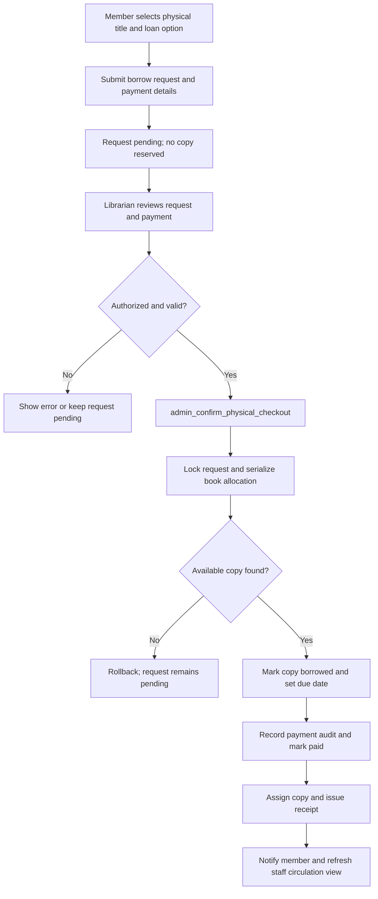

# Smart Lib — Product Requirements Document

**Version:** 2.0
**Status:** Product baseline and release requirements
**Last updated:** 2026-10-14
**Product owner:** Smart Lib project team
**Audience:** School stakeholders, library staff, product/design, and engineering

> This PRD distinguishes the behavior present in the repository from desired release requirements and future work. “Implemented” means that a UI, route, or database workflow is present in the source; it does not prove that production configuration, Supabase migrations, scheduled jobs, or third-party services are live. Do not treat an implemented feature as production-verified until its release checks pass.

## 1. Product overview

Smart Lib is a school library and study workspace for students, faculty, and administrators/librarians. It combines digital learning resources with a separate physical-book circulation workflow. Members can discover resources, access eligible digital files, organize study work, contribute materials, and track points. Library staff manage membership, digital resources, physical inventory, QR labels, circulation, contribution decisions, and payment evidence.

### Product vision

Make useful academic resources easier to discover and access while preserving privacy, equitable physical-book circulation, and accountable library operations.

### Product principles

1. **Digital and physical access are different products.** An e-book does not become unavailable because a physical copy is borrowed.
2. **No unnecessary approval for earned digital access.** Eligible free and points-based e-books unlock automatically after the database confirms access.
3. **Physical handover remains staff-controlled.** A request or payment submission is not a checkout; a librarian verifies the transaction and copy before handover.
4. **AI assists; accountable people decide.** AI contribution screening and payment-reference extraction are advisory, not final approval or proof of payment.
5. **Least privilege and private-by-default records.** Public availability must never reveal borrower identity, payment evidence, or account activity.
6. **The database is authoritative.** Client-side UI states cannot grant access, assign roles, confirm payments, or allocate physical copies.

## 2. Goals and non-goals

### Goals

- Provide reliable member authentication and role-aware student, faculty, and administrator experiences.
- Make digital materials and physical-book availability discoverable.
- Grant eligible free or points-based e-book access promptly and protect the corresponding files.
- Support copy-level physical inventory, QR identification, opt-in availability alerts, receipts, returns, and exception handling.
- Let members submit academic materials and see review/points outcomes; approved contributors receive permanent access to their published material, while points-based unlocks by other members split 50% to the contributor and 50% to the library.
- Bring study tools, points, notifications, and an academic assistant into the member experience.
- Give staff a coherent place to manage members, resources, requests, and circulation.
- Establish measurable security, accessibility, reliability, and release-readiness criteria.

### Non-goals for the current release

- Replacing the physical book, librarian judgment, or the school's official student-information system.
- Treating AI output, OCR, uploaded images, or a typed payment reference as payment settlement.
- Fully automatic paid e-book settlement before a trusted payment provider integration is available. The current premium flow is staff-verified and requires payment evidence.
- Claiming that browser UI controls can prevent operating-system screenshots or external photography.
- Guaranteeing 24/7 availability solely through application code; uptime also depends on hosting, database, operations, and support arrangements.
- Building a full learning-management system, gradebook, institutional email suite, or general-purpose AI chatbot.

## 3. Users, roles, and access

| Persona / role | Primary needs | Expected capabilities |
|---|---|---|
| Student | Find resources, read, borrow, study, and understand points/access status | Member dashboard, digital access, physical requests and availability alerts, reader and study tools, profile, contributions, points, notifications, assistant |
| Faculty | Locate course-relevant materials and borrow/access library resources | Member workspace and eligible student-like access; faculty rank and taught-course details |
| Administrator / librarian (`admin`) | Maintain the collection and member records; decide staff-controlled workflows | Admin dashboard, catalog/material management, account and academic-catalog management, request/contribution review, physical circulation, fee/payment verification, access grants, points/recognition quick actions, analytics and audit surfaces |
| Public visitor | Check the physical collection before visiting | Read-only public physical-catalog information and aggregate availability; no account data or borrower identities |

Application roles are `student`, `faculty`, and `admin`; librarian is represented by `admin`, not a separate role. New self-registered accounts default to student. Role changes are privileged administrative actions and must not be available through ordinary member profile editing.

Student profile attributes include name, school, department, course/program, and year level. Faculty profiles can include school, department, academic rank, and multiple taught courses. School and department are currently free-text profile fields; faculty ranks and academic courses have administrator-managed lists. A member may update permitted personal fields, but cannot self-promote or alter protected role/rank assignments.

## 4. Scope, priority, and implementation status

Priorities: **P0** = required before public production launch; **P1** = core product capability; **P2** = planned enhancement; **P3** = optional/future. Status is source-based and subject to deployment verification.

| Priority | Capability | Status at PRD update |
|---|---|---|
| P0 | Authentication, role authorization, private member data, and production secrets | Present in source; authorization, Supabase RLS, environment configuration, and recovery flows require release verification |
| P0 | Reliable schema/deployment setup against the target Supabase project | Consolidated schema exists for a fresh project; existing populated projects require a reviewed, staged upgrade path and backup |
| P0 | Reliable physical checkout/return and no duplicate copy allocation | Transactional functions and UI exist; live database, concurrency, and recovery tests still required |
| P0 | Automatic eligible free/points digital access; protected PDF authorization | Implemented in source/schema; verify database functions, grants, and storage privacy in staging |
| P0 | Error reporting, operational monitoring, backup/restore, and scheduled reminder setup | Not fully verified/configured by the QA pass; release gate |
| P1 | Student and faculty dashboards, profile details, member self-service | Present; profile role and data policies require validation |
| P1 | Unified digital/e-book catalog with PDF attachment management, access requests, reader, reading progress, notes, highlights, and drawings | Present; the admin workflow uses one digital catalog with attach/replace PDF actions; verify end-to-end with protected files and test accounts |
| P1 | Excel-style physical catalog, copy records, printable QR labels, requests, payment evidence, availability alerts, receipts, return/lost-item handling | Present in source/schema; public privacy, realtime delivery, and full circulation test required |
| P1 | Contribution upload, revision, AI screening, administrator decision, and post-approval points | Present in source; AI remains advisory and points are tied to human approval |
| P1 | Member points wallet, transaction history, recognition and achievement surfaces | Present in source/schema; confirm policy, transaction integrity, and optional-table behavior |
| P1 | Admin member management, academic rank/course lists, library operations, dashboard access-grant quick action, and audit surfaces | Present in source; validate staff-only authorization and data integrity |
| P1 | Premium e-book pricing, payment-evidence submission, staff verification, permanent access, and digital receipts | Implemented in source/schema; verify payment policy, storage privacy, and staff reconciliation in staging |
| P2 | OCR-assisted physical-book table-of-contents entry during registration | Proposed enhancement; not represented as a currently delivered workflow |
| P2 | Admin-configurable contribution point bonuses and broader reward campaigns | Existing approval/points foundations; configurable award policy needs product definition and implementation |
| P2 | Outbound email notification worker and delivery status | Email queue exists, but the application does not itself prove delivery; worker/provider required |
| P2 | Enhanced catalog filters and richer discovery | Partial/future; do not promise features unless enabled and verified |
| P3 | Automated ISBN lookup, self-service circulation kiosk, advanced analytics, and richer AI recommendations | Optional, dependent on school policy, budget, privacy review, and operational capacity |

## 5. Core user journeys

### 5.1 Account creation and sign-in

1. A member registers with email and password or receives an administrator-created account.
2. A new self-registered account receives the student role by default.
3. The member verifies/signs in as required by configured authentication policy.
4. The application reads the trusted profile role and routes the member to the appropriate workspace.
5. A missing profile, disabled account, expired session, or failed auth service produces a recoverable message; it must not grant broader access or create a redirect loop.
6. Members can sign out and use configured password-recovery flows.

### 5.2 Digital browse, access, and reading

1. A student or faculty member searches or browses digital books/materials.
2. The catalog clearly presents whether access is free, points-based, restricted, or premium, plus the available access duration or configured price.
3. The member requests eligible free or points access.
4. The server/database validates the member, resource, duration, existing access, and point balance. It grants free access or atomically deducts points and grants access.
5. On success, the member can read immediately; no administrator approval is inserted into this eligible free/points flow.
6. Only an authorized member with a current loan/grant, an allowed contributor entitlement, or an administrator role can retrieve the protected PDF.
7. The reader may use visible identity watermarking and limited interaction deterrents. The product must describe these as deterrence, not screenshot prevention.
8. Members can view progress and manage their own notes, highlights, and study drawings.

The current dashboard offers access durations of 1, 3, 7, 14, and 30 days. Product policy may change these values; the UI and database validation must always agree.

### 5.3 Paid digital access

Premium e-book checkout uses a staff-verified payment-evidence flow. The member submits the configured price, transaction reference, and a private proof image; an authorized administrator/librarian verifies the payment against the merchant record. A screenshot, OCR extraction, or typed reference alone never grants access. Approval creates permanent access, a digital receipt, and a member notification. A future trusted provider webhook may automate this decision, but it is not required for the current workflow.

### 5.4 Physical book discovery and circulation

1. A visitor/member browses the physical catalog and sees title details and aggregate availability, not borrower identities.
2. A member can open a title from the catalog, scan its QR code with the in-app scanner, or follow a QR URL. The system shows the title, copy status, and structured location such as “Science section · Shelf 2 · Row 3.”
3. A member may read the item in the library without creating a request. This is an informational/read-in-library use case, not a circulation record.
4. If borrowing, the member chooses an available loan option and submits the configured payment details/evidence if required. The request is pending and does not reserve or lock a copy.
5. The librarian sees new requests through the admin circulation view and validates member eligibility, payment status, loan terms, and current availability.
6. At confirmation, the database atomically selects and locks an available copy, assigns it to the request, marks it borrowed, and creates the due date and receipt. If no copy is available, confirmation fails safely and the request remains pending.
7. The completed checkout is written to physical loan history. The member can view request/loan status and receipt.
8. When no copy is available, the member may turn on an availability alert from the book card. When inventory changes from no available copies to at least one, all eligible subscribers are notified at once. The alert does not reserve a copy; borrowing remains first come, first served, and checkout requires the normal request and librarian confirmation.
9. The librarian records return, damage, loss, or a justified resolution. Fines or replacement charges require an approved school policy and must not be invented or silently charged.
10. Each physical copy has an individual identifier, QR token, circulation status, and structured location. Scanning identifies a copy or safe public information, but does not authorize checkout or reveal a borrower.

The librarian queue is organized around operational states rather than a single generic approval list:

- **Pending request:** the member has submitted a borrowing request and no copy has been assigned.
- **Awaiting payment:** payment evidence or payment verification is still incomplete.
- **Ready for checkout:** payment is verified and staff can confirm handover if a copy is available.
- **Checked out:** a copy has been assigned, the due date and receipt exist, and the loan is active.
- **Overdue:** an active loan has passed its due date and requires follow-up.
- **Return pending:** the member has begun or requested a return, but staff has not completed the return record.

Read-in-library use remains a separate discovery action. It does not create a physical request, assign a copy, change availability, or enter loan history.

### 5.5 Unified digital catalog and PDF management

1. Digital titles and their optional PDF files are managed through one admin catalog; “PDF materials” is not a second catalog or duplicate book list.
2. Administrators can search, filter, sort, paginate, create, edit, delete, and inspect digital/hybrid titles from the catalog.
3. Each catalog row can show title, author, ISBN, category, format, access mode, access duration, PDF status, and available actions.
4. Administrators can attach or replace a protected PDF on an existing digital/hybrid title without creating a duplicate title record.
5. Students see only eligible digital/hybrid resources in the digital catalog; physical-only titles are excluded from digital/e-book lists.
6. A PDF file is readable only through the applicable digital access/grant rules. File attachment does not itself grant access.

### 5.5 Contribution review and recognition

1. A signed-in member submits academic material metadata and a PDF, or revises an eligible prior submission.
2. The system validates file type and size and stores the document privately.
3. Optional AI screening summarizes relevance, usefulness, and concerns for a human reviewer.
4. An administrator reviews the material and makes the final approve/reject decision with feedback.
5. Points are awarded only according to the recorded approved decision and configured policy; AI scores alone do not award points.
6. The contributor can see status, feedback, and points history.

### 5.6 Administrator operations

Administrators sign in and manage member profiles/roles, faculty rank and course catalogs, the unified digital/PDF catalog, physical titles/copies/QR labels, borrow requests, contributions, payment evidence, access grants and points through dashboard quick actions, and operational reports. Physical requests and checked-out copies are presented as compact sections/cards with details available in modals. Sensitive actions require server/database authorization, confirmation for destructive actions, clear success/failure messages, and an audit record where applicable.

### 5.7 Notifications and reminders

Members see in-app notifications for relevant account and circulation events. Physical availability alerts are event-triggered when an unavailable title becomes available; they do not depend on scheduled processing. Optional maintenance may expire stale pending requests and create due-soon/overdue reminders. An email queue alone is not an email delivery service; email notifications are not considered delivered until a worker/provider reports success.

## 6. Functional requirements

Every requirement is testable. Status reflects the current source baseline; production launch requires evidence against the live/staging environment.

| ID | Priority | Requirement | Baseline |
|---|---|---|---|
| FR-001 | P0 | The system shall authenticate members and associate each session with a trusted member profile. | Implemented; verify provider configuration |
| FR-002 | P0 | Self-registration shall assign the least-privileged member role by default. | Implemented in source/schema |
| FR-003 | P0 | Role checks shall be enforced by the server/database for every privileged read or mutation, not only by hiding UI controls. | Implemented in parts; full policy audit required |
| FR-004 | P1 | Student and faculty members shall have member workspaces; administrators shall have separate administrative tools. | Implemented |
| FR-005 | P1 | Members shall view and update only permitted profile fields; role and privileged academic assignments shall not be self-editable. | Implemented in parts; verify all paths |
| FR-006 | P1 | Member profiles shall support full name, school, department, student course/program and year; faculty may have an academic rank and multiple assigned courses. | Implemented in source/schema; check data policy |
| FR-007 | P1 | Administrators shall be able to manage available faculty ranks and academic courses and edit eligible member profiles. | Implemented in source/schema |
| FR-008 | P1 | Members shall browse and search the digital library and view each resource's access mode and duration terms. Physical-only titles shall not appear in the digital/e-book catalog. | Implemented; verify catalog/schema alignment |
| FR-009 | P1 | Administrators shall manage digital/e-book metadata and protected PDF references in one searchable catalog; attaching or replacing a PDF shall update the existing title rather than create a duplicate catalog entry. | Implemented; verify file access and storage rules |
| FR-009A | P1 | The admin digital catalog shall provide an Excel-style table with search, filtering, sorting, pagination, format/PDF status, and per-row create/edit/delete/read/attach-PDF actions. | Implemented in source; verify usability and authorization |
| FR-010 | P0 | A valid free digital-access request shall grant access without administrator approval. | Implemented in source/schema; staging test required |
| FR-011 | P0 | A valid points-based digital-access request shall atomically verify and deduct the required points and create access; failure shall not partially charge the member. | Implemented in source/schema; concurrency test required |
| FR-012 | P0 | Eligible free/points digital access shall not depend on physical stock or a librarian decision. | Implemented as product flow |
| FR-013 | P1 | Members shall view their pending, active, expired, returned, or otherwise resolved digital access state. | Implemented in member workspace |
| FR-014 | P1 | Members shall renew or return eligible digital access within the configured limits and receive a clear result. | Implemented in source/schema |
| FR-015 | P0 | Protected digital files shall be retrievable only after current authorization, except for explicitly authorized admin/contributor cases. | Implemented in source; security test required |
| FR-016 | P1 | The reader shall support reading progress and member-owned notes, highlights, and drawings without exposing another member's study data. | Implemented in source/schema |
| FR-017 | P0 | Premium digital checkout shall require a configured positive price, private payment evidence, and authorized staff verification; uploaded evidence or AI extraction alone shall never grant access. | Implemented in source/schema; staging payment and privacy test required |
| FR-018 | P2 | After provider integration, verified paid digital payment shall create a single access grant and receipt automatically; duplicate webhook delivery shall not duplicate grants or charges. | Future |
| FR-019 | P1 | Public physical-catalog views shall disclose title metadata, aggregate availability, and safe structured location data only, with no member, request, payment, or private QR-token data. | Implemented via public projection; privacy-test required |
| FR-020 | P1 | Administrators shall manage an Excel-style physical book catalog with searchable/filterable/sortable/paginated book-level fields including title, author, ISBN, category, format, total/available/borrowed counts, and location summary. | Implemented in source/schema; verify usability and authorization |
| FR-020A | P1 | Administrators shall create/update physical titles, register individual copies with distinct copy codes and QR tokens, view copies, add copies, edit copy locations, and manage physical loan fees/options. | Implemented in source/schema |
| FR-021 | P1 | A member shall open a physical title from the web catalog or QR scan, view copy status/location, choose read-in-library use without a request, submit a pending borrow request when a copy is available, or turn on/off an availability alert from the book card when no copy is available. | Implemented in source/schema; verify QR/browser coverage |
| FR-021A | P1 | The system shall support an in-app QR scanner where the browser provides `BarcodeDetector`, while retaining safe direct QR-link resolution as a fallback. | Implemented in source; browser compatibility test required |
| FR-022 | P0 | Checkout shall require authorized staff confirmation and shall atomically select and associate one currently available copy with the request only at confirmation; a pending request shall not reserve or lock a copy. | Implemented in source/schema; concurrency-test required |
| FR-023 | P1 | Physical payment evidence shall remain pending until verified by authorized staff; AI/OCR extraction may assist entry but shall not confirm payment. The librarian queue shall distinguish pending, awaiting-payment, ready-for-checkout, checked-out, overdue, and return-pending work. | Partially implemented; verify queue states and payment policy |
| FR-024 | P1 | The system shall issue a receipt and due date after successful physical checkout and record return, renewal where allowed, and closure outcomes. | Implemented in source/schema |
| FR-025 | P1 | When a physical title transitions from no available copies to at least one available copy, the system shall notify all eligible members who opted into an availability alert. Alerts shall not reserve copies; staff confirms checkout on a first-come, first-served basis. Members shall be able to turn alerts off. | Implemented in source/schema; database broadcast and member controls require isolated validation |
| FR-026 | P1 | Administrators shall record physical-copy damage/loss and resolve the associated hold through an explicit staff action. | Implemented in source/schema |
| FR-027 | P1 | QR scanning shall resolve the identified physical copy or safe public information, show title/status/location, and never grant checkout rights or reveal borrower identity. | Implemented in source/schema |
| FR-027A | P1 | When an authorized librarian confirms checkout, the system shall create/update detailed physical loan history with request, student, book, copy, payment, due date, receipt, return condition, and status fields. | Implemented in source/schema; history trigger and live-data test required |
| FR-028 | P2 | Physical title registration shall support optional table-of-contents text; image capture/OCR assistance shall be added only with human review and privacy controls. | Proposed; not currently delivered |
| FR-029 | P1 | Members shall submit new academic contributions and revise eligible submissions, receiving a visible status and review feedback. | Implemented in source/schema |
| FR-030 | P1 | AI contribution screening shall provide advisory relevance/usefulness/concern signals to reviewers and shall not make the final approval decision. | Implemented in source; verify Gemini config and failure path |
| FR-031 | P1 | Contribution points shall be awarded only after a human-approved decision according to the recorded policy. | Implemented in source/schema |
| FR-032 | P1 | Members shall view their point balance and transaction history; mutations shall be auditable and resistant to duplicate awards/deductions. | Implemented in source/schema; verify integrity |
| FR-033 | P2 | Administrators shall configure contribution/reward point policies and any bonus award; published policies shall be clear to members. | Partially supported; configuration policy not complete |
| FR-035 | P1 | Members shall view and update in-app notifications; unauthenticated requests shall receive an authentication response rather than an internal-server error. | API exists; unauthenticated path failed QA |
| FR-036 | P0 | Availability alerts shall be generated from inventory changes without a scheduled job. Optional physical maintenance shall expire stale pending requests or create reminders only when explicitly enabled and invoked through an authenticated, observable process. | Availability trigger implemented; optional maintenance scheduler not verified |
| FR-037 | P1 | The assistant shall answer supported catalog, policy, or member-loan questions using only data the caller is authorized to access. | Implemented foundation; response fidelity and scope require testing |
| FR-038 | P1 | Assistant sessions and messages shall be private to their owner, with authorized session deletion. | Implemented in source/schema; RLS test required |
| FR-039 | P1 | Administrators shall see actionable metrics and manage requests, members, resources, contributions, access grants, points, and audit information permitted by their role. Physical request and copy changes shall update the circulation view through Supabase Realtime when the deployment publication is enabled. The physical queue shall prioritize pending operational work and expose payment, checkout, overdue, and return states. | Partially implemented; verify each surface, queue state, and realtime delivery |
| FR-039A | P1 | Admin request pages shall provide fast search, status filtering, and pagination. E-book requests shall be searchable by member, book, status, notes, and request ID; physical requests and availability-alert subscriptions shall be searchable by member, book, payment details, and request ID, with pending and alert-subscription filters. | Implemented in source; verify usability with larger request sets |
| FR-040 | P0 | Errors, empty states, loading states, and validation failures shall be understandable and shall not present a failed operation as successful. | Partially implemented; test and fix before launch |
| FR-041 | P1 | Users shall be able to reach privacy, terms, cookie, authentication recovery, and branded error/not-found experiences. | Pages present; deployed links/configuration require verification |

## 7. Data and information model

The system's core entities and responsibilities are:

| Entity | Purpose and key relationships |
|---|---|
| Profile | Member identity, role, contact, school/department, student course/year, points, and optional faculty rank |
| Faculty rank, academic course, faculty-course assignment | Controlled academic attributes and many-to-many faculty course associations |
| Book | Digital or physical/hybrid title metadata; digital entitlement is independent of copy inventory |
| Physical book copy | One individually identified item, QR token, location/status, and due-date state |
| Digital borrow request / access grant | Time-limited or other eligible digital entitlement, points paid, status, and expiry |
| Physical request / availability-alert subscription | Member's pending request, loan terms/payment state, optional checkout assignment, checkout/return, due date, receipt, or opt-in alert subscription; alerts never reserve inventory |
| Contribution | Member-submitted academic material, private file reference, AI advisory result, review status/feedback, and points outcome |
| Point transaction, recognition award, reward, achievement | Immutable/accountable point ledger and member reward/recognition state |
| Study note, highlight, drawing, reading progress | Member-owned study artifacts associated with a digital resource |
| Notification, email queue, reminder event | In-app event and queued/scheduled communication state |
| Assistant session/message | Member-owned conversation and stored assistant exchange |
| Fine, audit log | Policy-based amounts and administrative action history |

Data retention periods, account deletion rules, consent language, and school-specific records obligations must be decided and documented before real member data is used. Private PDFs, payment proofs, study records, assistant content, and account details must not be exposed through public catalog responses.

## 8. UX, accessibility, and content requirements

- Provide clear role-specific navigation and preserve context when returning from a detail or workflow screen.
- Show skeleton/loading states only while loading; display a distinct error state when data cannot be retrieved.
- Explain access price/points, access duration, physical loan period/fee, availability-alert status, due date, and next steps before the member commits.
- In catalog tables, keep book-level availability separate from copy-level status. Make title, author, ISBN, category, format, total/available/borrowed counts, and location easy to scan on desktop and usable on mobile.
- Keep high-detail admin operations such as copy lists, QR status, location editing, request details, and checkout confirmation inside focused modals without duplicating the catalog or request data.
- Distinguish “requested,” “payment submitted,” “payment verified,” “checked out,” “returned,” and “access granted”; never use ambiguous “approved” labels where they imply something else.
- Give each destructive or money-related action an explicit confirmation, actor, result, and recovery/support path.
- Ensure keyboard operation, visible focus, form labels, meaningful headings, status announcements, usable touch targets, and readable color contrast. Target WCAG 2.2 AA review.
- Support mobile layouts for common member and administrator tasks, including catalog, profile, request tracking, and physical circulation.
- Reader protection may include personalized visible watermarks and browser-level deterrents, but help/content must disclose that screenshots and external photography cannot be prevented reliably.
- Legal/policy copy must be approved by the school; the application must not imply guarantees it cannot enforce.

## 9. Non-functional requirements

Targets below are release objectives, not measured claims. Record actual test evidence before declaring compliance.

| ID | Area | Requirement / target |
|---|---|---|
| NFR-001 | Availability | Target at least 99.5% monthly service availability after launch, excluding announced maintenance, subject to hosting/database SLAs and a monitored incident response plan. |
| NFR-002 | Performance | On a typical school connection, primary catalog content should be usable within 2 seconds at p95; catalog search/filter/sort results should return within 1 second at p95 for the agreed initial collection size; realtime circulation updates should normally appear without a manual refresh. Measure from the deployed environment. |
| NFR-003 | Integrity | Points deduction/grant, physical copy allocation, payment decision, checkout, return, and receipt issuance must be transactional/idempotent where applicable. |
| NFR-004 | Security | Enforce server-side authentication and authorization, row-level data ownership, least privilege, input validation, private file storage, and protected secret handling. |
| NFR-005 | Privacy | Public endpoints expose only approved catalog fields and aggregate counts. Minimize personal data sent to third-party AI services and document purpose, retention, and consent. |
| NFR-006 | Reliability | Failure of optional AI, email, or analytics services must produce an explicit user/staff state and must not corrupt core circulation, access, or point transactions. |
| NFR-007 | Accessibility | Meet WCAG 2.2 AA for core journeys, with keyboard-only and screen-reader checks and no color-only status meaning. |
| NFR-008 | Compatibility | Validate current stable Chrome, Edge, Firefox, and Safari, including mobile Safari and common Android/desktop viewport sizes. |
| NFR-009 | Observability | Capture structured server errors, failed privileged mutations, payment/circulation outcomes, scheduled-job health, and uptime without logging credentials or private file contents. |
| NFR-010 | Recovery | Backups must be automatic, access-controlled, and restore-tested; document recovery time and data-loss objectives approved by the school. |
| NFR-011 | Maintainability | Database setup and upgrade instructions must distinguish a fresh-project baseline from a safe migration of an existing populated database. |
| NFR-012 | Configuration | Production must use HTTPS, a configured canonical site origin, non-placeholder secrets, and environment-specific values outside source control. |

## 10. Security, privacy, and abuse prevention

1. Enforce role and ownership checks in server routes and database policies/functions; treat client UI state as untrusted.
2. Keep Supabase service-role, Gemini, cron, and provider credentials server-side only. Do not expose them as public client variables.
3. Require private storage and authorization checks for protected PDFs and payment proof files. Use short-lived access or authorized server streaming.
4. Validate upload size, file extension, MIME, and actual content where feasible; use non-user-controlled storage keys and clean up orphaned uploads after failed submissions.
5. Rate-limit authentication-sensitive, upload, AI, request, and expensive search paths; define abuse quotas and alerting.
6. Make payment confirmations and point changes idempotent, auditable, and attributable. Avoid logging full payment proofs or credentials.
7. Use least-privilege database grants and review every privileged/security-definer function for a fixed search path, caller authorization, validation, and safe execute grants.
8. Restrict public physical catalog functions to minimal metadata and aggregate availability. Never return member names, private QR tokens, request records, or payment data.
9. Document if/when Gemini receives contribution content or payment images, what data is sent, retention expectations, failure fallback, and required school approval.
10. Maintain a tested incident and credential-rotation process.

## 11. Technical context and constraints

The current application is a Next.js web application using React/TypeScript and Supabase Auth, PostgreSQL/RLS/RPC, and Storage. Optional integrations include Google Gemini for AI assistance/screening and Google Drive for storage. There is no verified production payment-provider integration or outbound email delivery worker in the current baseline.

### System boundaries

- Browser application: public landing/catalog, authentication, member workspaces, reader-based notes/highlights/progress, and admin workflows.
- Application server/API routes: session-aware protected file access, member/admin operations, notifications, AI calls, and scheduled job entry points.
- Supabase: authoritative authentication/profile data, relational records, transaction/authorization functions, and storage.
- Optional external services: Gemini, Google Drive, payment provider (future), and email delivery worker/provider (future).

### Physical checkout data flow

The physical payment and checkout flow is staff-controlled. A member may submit a request and payment evidence, but only the database-authorized librarian/administrator checkout action can record payment as paid, assign a copy, and issue a receipt.

1. The member browses a physical title and submits a borrow request with the selected loan option and payment details. The request remains `pending`, has no `copy_id`, and does not reduce availability.
2. The browser sends the staff checkout action to the application/database function `admin_confirm_physical_checkout`.
3. The database verifies the caller role, request status, amount, payment state, and notes; locks the request and serializes allocation for the requested book.
4. The database locks one available physical copy, marks it `borrowed`, updates the request with payment audit information, assigns the copy and due date, sets `payment_status = paid`, and creates the receipt number in one transaction.
5. The transaction creates an in-app notification for the member. The admin view receives the resulting request/copy state through the normal authorized data path and, where enabled, Supabase Realtime.
6. If validation or copy allocation fails, the transaction raises an error and the request/copy/payment state remains unchanged. No receipt or successful checkout notification is produced.

### Physical payment and circulation data structure

Only the records needed for the physical checkout decision are shown here. The relational database is authoritative; client-side status labels and uploaded evidence are not proof of payment.

| Record | Important data | Relationship / responsibility |
|---|---|---|
| `books` | Title metadata and `catalog_type` | Parent title for physical copies and loan options; physical availability comes from copy rows, not legacy digital counts. |
| `physical_book_copies` | `id`, `book_id`, copy code, QR token, `status`, location, `checked_out_at`, `due_date` | One physical item per row. A successful checkout changes exactly one available copy to `borrowed`. |
| `physical_loan_options` | Book, loan duration, PHP fee, active/configuration fields | Defines the expected `fee_amount` and `duration_days` used during checkout validation. |
| `physical_book_requests` | Member/book/loan option, `status`, `copy_id`, `payment_method`, `payment_status`, payment reference/proof, `fee_amount`, `duration_days`, `receipt_number`, `checked_out_at`, `due_date` | Source-of-truth workflow record. Pending requests have no copy assignment. |
| Payment audit fields on `physical_book_requests` | `payment_received_amount`, `payment_verified_at`, `payment_verified_by`, `payment_notes` | Records the amount physically received, verification time, authorized verifier, and optional note (maximum 500 characters). Amount must be non-negative and equal to the configured fee at confirmation. |
| `physical_book_loan_history` | Request/member/book/copy, payment, checkout, due date, return condition, and status | Synchronized history projection created/updated from completed physical checkouts; current request/copy state remains authoritative. |
| `notifications` | Member, event type, title/message, reference request | In-app confirmation after a successful physical checkout. |

The checkout transaction has these required invariants: the caller is an authorized librarian/administrator; the request is `pending`; GCash requests are awaiting verification; the received amount equals the configured fee to two decimal places; one currently available copy is locked and assigned; and payment, copy status, due date, receipt, and notification are committed together or not at all.

### Database installation rule

[`supabase/COMPLETE_SCHEMA.sql`](./supabase/COMPLETE_SCHEMA.sql) is a consolidated schema intended for a fresh Supabase project. It must not be blindly rerun against an existing populated project as an upgrade. Existing installations need a reviewed migration derived from the actual deployed schema, tested in staging with a verified backup and rollback/recovery plan. Confirm the live database contains every column, table, function, trigger, and policy required by the deployed application.

## 12. Success metrics and acceptance criteria

### Product success metrics

- At least 95% of test members complete registration/sign-in and reach the correct role workspace without staff intervention.
- At least 95% of eligible points-based access tests either grant access and debit the exact amount once, or fail without a debit.
- 100% of physical test checkouts require authorized staff confirmation, leave pending requests unassigned, and associate exactly one available copy only at successful checkout.
- 100% of public physical-catalog test responses omit borrower identity, private requests, payment evidence, and private QR tokens.
- At least 95% of contribution submissions can be followed from submission through decision, feedback, and correct points outcome.
- At least 95% of representative members complete core tasks on mobile without horizontal overflow or blocked controls.
- Meet the availability and performance objectives in NFR-001 and NFR-002 after instrumenting the deployed service.

### Release acceptance criteria

Production launch is eligible for sign-off only when:

- `npm test` and `npm run build` pass in the release environment.
- Authentication, password recovery, role routing, and unauthorized requests have automated coverage.
- Student, faculty, and admin permissions pass positive and negative access-control tests.
- Digital free/points grant, point deduction, protected file access, renew/return, and duplicate/concurrent request behavior pass.
- Physical request, payment verification, checkout, receipt, return, lost/damaged resolution, broadcast availability alerts, optional maintenance expiry, and QR lookup pass with isolated test data.
- Contribution upload, AI-unavailable fallback, human decision, resubmission, and post-approval points pass.
- No critical/high security finding remains unresolved; secrets, RLS, storage privacy, and API error handling have been reviewed.
- The Supabase production schema is reconciled with the exact release version; migration and rollback/restore are rehearsed in staging.
- `NEXT_PUBLIC_SITE_URL` is set to the approved canonical HTTPS domain; deployed sitemap and robots output are verified.
- Uptime/error monitoring, scheduled physical-reminder processing, backup alerts, and support ownership are active and tested.
- Privacy, terms, cookie notice, AI-processing disclosure, physical borrowing rules, fees, and screenshot-protection limitations have school approval.
- Cross-browser and accessibility checks for core journeys are complete, with known defects recorded and accepted by the product owner.

## 13. QA findings and open release risks

The 2026-10-09 targeted QA pass built the application and manually checked representative admin flows. It was not a full system certification.

| Finding | Impact | Required action |
|---|---|---|
| Unauthenticated `GET /api/notifications` returned 500 instead of 401 during QA. | Incorrect auth failure behavior; can obscure the real cause and pollute error monitoring. | Fix the auth error handling and add unauthenticated/expired-session tests. |
| `/sitemap.xml` returned 500 when `NEXT_PUBLIC_SITE_URL` was unset. | Deployment will fail to serve sitemap until canonical HTTPS origin is configured. | Set the production environment variable and verify sitemap/robots on the deployed domain. |
| A first dashboard load reported `books.premium_price` missing; after a server restart the dashboard loaded. | Possible stale/transient database/cache issue or schema drift; unresolved by local smoke testing. | Compare the deployed database against the release schema and run an end-to-end catalog query in staging. |
| `npm test` is a static system/schema-presence check; the repository had no automated browser/integration suite at QA time. | Core persistence, authorization boundaries, and concurrency are not proven by the current canonical test command. | Add and run automated tests for the critical journeys before launch. |
| Docker-backed isolated infrastructure, backup restoration, production uptime, load, and broader cross-browser checks were not performed. | Production operational readiness and scale behavior remain unknown. | Complete staging and operations gates; record evidence and accepted limits. |

Full evidence is recorded in [`runtime-validation-report.md`](./runtime-validation-report.md). Findings should be updated as each is resolved; do not silently remove a risk without test evidence.

## 14. Roadmap

### Phase 0 — Production foundation (P0)

- Reconcile Supabase schema, policies, storage buckets, grants, and environment configuration.
- Correct API authentication/error contracts and add automated test coverage.
- Add monitoring, alerting, backup/restore rehearsal, and operational ownership.
- Validate physical and digital workflows in a staging environment with isolated test identities/data.
- Complete privacy/security/accessibility and release acceptance reviews.

### Phase 1 — Core library launch (P1)

- Launch member/student/faculty workspaces and admin library operations.
- Operate the public-safe physical catalog and staff-confirmed physical circulation.
- Offer automatic free/points digital access and protected reading.
- Enable member study tools, contributions with human review, and points history.

#### Physical circulation delivery plan

The physical workflow is a focused Phase 1 delivery. Its existing copy, location, request, checkout, history, and realtime foundations should be retained; the work below reconciles their contracts and makes the member and librarian journeys consistent.

**Step 1 — Reconcile the circulation contract (P0 gate)**

- Treat a pending physical request as an intent to borrow, not a reservation. It has no assigned copy and does not change any copy's availability.
- Reconcile the student UI, RPCs, consolidated schema, migrations, and database tests with checkout-time copy assignment. Remove user-facing “reserve/reserved copy” language and obsolete reserved-copy expectations where they contradict the active workflow.
- Keep availability alerts as opt-in subscriptions, not a FIFO queue. When stock changes from unavailable to available, notify all eligible subscribers; the alert does not guarantee or hold a copy. Members submit normal requests, and staff confirms checkout against current inventory on a first-come, first-served basis.
- Preserve the existing rule that only authorized staff confirmation atomically assigns and marks a copy borrowed.

**Acceptance checks:** a pending request has `copy_id = null`; creating or cancelling it does not alter an available copy; a second member can still submit a request while stock is available; concurrent staff checkouts cannot assign the same copy; a checkout with no available copy fails without falsely completing the request.

**Step 2 — Make physical discovery location-first (P1)**

- In the member catalog and QR-resolved title view, make aggregate availability and structured location easy to scan: section, shelf, row, and position, with the legacy location shown only as a fallback.
- For a scanned copy, identify its title and copy status. If it is unavailable, show other currently available locations when known and explain that a scan does not reserve or authorize handover.
- Keep read-in-library as an immediate informational path: show the title/location and let the visitor proceed without creating a borrow request, availability-alert subscription, payment, or loan-history row.
- Put an explicit “Notify me” availability-alert control on an unavailable physical-book card. Explain that an alert does not reserve a copy and borrowing is first come, first served; staff completes checkout at the desk.

**Acceptance checks:** public/catalog data reveals no borrower identity, private request/payment fields, or QR token; location labels handle missing metadata without displaying blank separators; read-in-library creates no circulation mutation; QR lookup works for available and unavailable copies on supported browsers and by direct link.

**Step 3 — Shape the librarian desk workflow (P1)**

- Keep the live pending-request queue and checked-out/return view, but present each request's member, title, request time, payment state/evidence, requested loan term, and current aggregate availability together.
- Make the primary staff action “Confirm checkout” (or payment verification plus checkout where applicable); state clearly that the database chooses an available copy at confirmation time.
- If inventory changed before confirmation, keep the request pending, show a recoverable explanation, and do not mark payment/checkout complete or issue a receipt.
- On success, show the assigned copy, due date, receipt, and borrower notification. On return, retain the existing condition/lost-item resolution flow and loan-history ledger.

**Acceptance checks:** request and copy changes refresh the authorized staff view through Supabase Realtime; checkout records exactly one copy and one history entry; return updates the same history record and copy condition; failures do not produce success UI or duplicate receipts/history.

**Step 4 — Verify the complete physical journey (P0 release gate)**

- Update database workflow tests for checkout-time allocation, cancellation, all-subscriber availability-alert semantics, concurrent requests/checkouts, payment verification, return conditions, lost-item holds, and loan-history synchronization.
- Add or extend browser tests for guest QR sign-in gating, member catalog location/status, read-in-library non-mutation, pending borrow request wording/status, and librarian queue updates where the test environment supports realtime.
- Run the focused database and browser checks against an isolated staging project; verify required migrations, realtime publication membership, RLS, and public-catalog privacy against the deployed schema before release.

**Exit criteria:** the PRD's physical circulation requirements pass with evidence from both database-level behavior tests and browser-level journey tests. A UI-only pass is insufficient for copy allocation, privacy, payment, or history guarantees.

### Phase 2 — Trusted payment and communication (P2)

- Integrate an approved payment provider for premium digital access using signed, idempotent webhooks to optionally replace manual verification.
- Add a transactional email worker with delivery/retry status.
- Add configurable contribution award policy and explicitly documented exception handling.
- Add table-of-contents capture/OCR as a reviewer-assisted optional physical catalog workflow.

### Phase 3 — Discovery and operational improvement (P2/P3)

- Expand public discovery, optional ISBN metadata lookup, analytics, and staff self-service tools based on usage and school policy.
- Reassess AI features against privacy, accuracy, cost, and user feedback evidence.

## 15. Assumptions and decisions

- The initial deployment serves one school/library organization; multi-tenant institution support is out of scope unless later approved.
- The school/librarian owns borrowing and retention policy. The approved initial Smart Lib policy applies to general-circulation physical books only: 14 calendar days, a two-day grace period, ₱5 per chargeable late day excluding Sundays and staff-entered public holidays, a ₱500 per-item cap, and lost classification after 30 consecutive overdue days with late-fine accrual stopped. Replacement charges remain outside Smart Lib. Physical overdue/lost items and unpaid physical fines block new digital checkouts; physical checkout and availability-alert subscriptions are blocked by physical overdue/lost items, and balances of ₱100 or more suspend borrowing privileges. Digital loans expire without overdue fines. Reserve/course-reserve, audiovisual, and equipment policies remain out of scope until explicitly approved.
- Free and points-based digital access is automatic when eligible and confirmed. Premium access requires staff verification of submitted payment evidence until a trustworthy provider integration is operational.
- Physical-book checkout, payment verification, copy handover, return, and exception resolution remain staff-controlled.
- AI processing is optional and advisory; human review remains authoritative.
- The product may deter casual copying but cannot technically guarantee prevention of screenshots, photography, or redistribution.
- Performance and availability targets are proposed release objectives; the project owner must confirm hosting, traffic assumptions, and service-level expectations before promising them to users.
