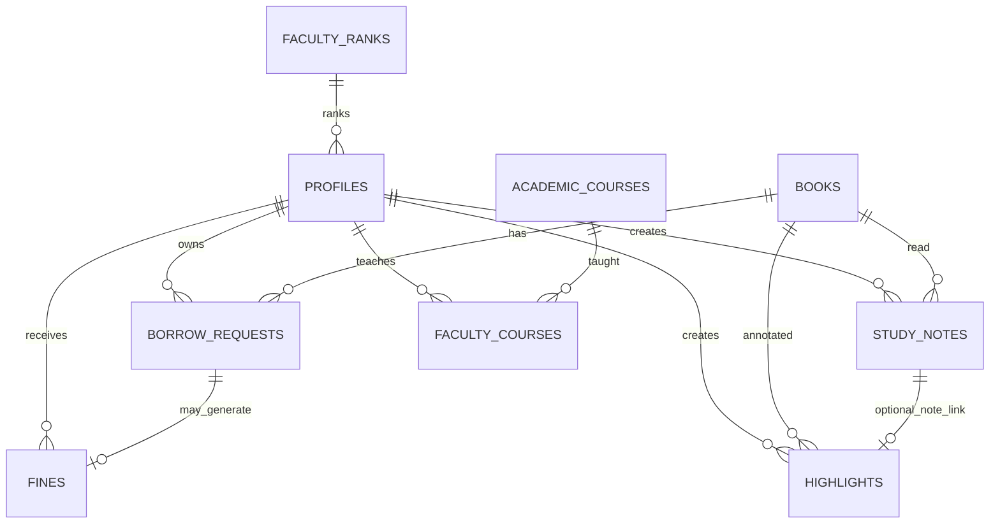

# Smart Lib schema and app model

This document captures the Supabase database schema and app flow actually used by the project.

## 1. Core auth and role model

### `public.profiles`
Used for role-aware auth routing and member profile details.

| Field | Type | Notes |
| --- | --- | --- |
| `id` | `uuid` | Supabase auth user id |
| `email` | `text` | Login email |
| `role` | `text` | `student`, `faculty`, or `admin` |
| `full_name` | `text` | Optional display name |
| `school` | `text` | Optional school or college |
| `department` | `text` | Optional department |
| `course` | `text` | Optional student course or program |
| `student_year` | `text` | Optional student year level |
| `faculty_rank_id` | `bigint` | Optional faculty title; references `faculty_ranks.id` |
| `created_at` | `timestamptz` | Default timestamp |

Typical app behavior:
- `/dashboard` checks `profiles.role`
- `admin` redirects to `/dashboard/admin`
- `student` and `faculty` redirect to `/dashboard/student`
- login and sign-up upsert into `profiles` if missing
- Schools and departments are free-text profile values until the institution supplies a managed directory.
- Administrators can edit member details and switch student/faculty roles. Faculty-only rank and course assignments are updated transactionally through `admin_update_member_academics()`; members cannot self-assign a rank.

### Faculty rank and course catalogs

| Table | Purpose |
| --- | --- |
| `public.faculty_ranks` | Administrator-managed academic titles/ranks, such as Instructor, Lecturer, or Professor. Deactivate entries instead of deleting used titles. |
| `public.academic_courses` | Administrator-managed courses/programs. Students select a course/program from this catalog when an administrator edits their profile. |
| `public.faculty_courses` | Many-to-many assignments connecting faculty profiles to the courses they teach. |

Authenticated users can read the catalogs; only administrators can manage catalog entries and faculty teaching assignments. The admin member-management screen supports multiple courses per faculty member.

## 2. Library catalog and lending flow

Physical circulation is handled separately from digital loans. Physical copies, physical requests, fees, and payment records must not change e-book availability or automatic points-based access.

`public.books.catalog_type` distinguishes `digital`, `physical`, and `hybrid` catalog entries. E-books have no stock or copy limit; `total_copies` and `available_copies` are legacy columns and must not control digital access. Physical inventory is managed only through `public.physical_book_copies`. Physical-only titles are excluded from the digital-reader catalog and access RPC.

### Physical collection and circulation

| Table | Purpose |
| --- | --- |
| `public.physical_book_copies` | One row per physical copy, with a unique code and QR token. Copy rows remain restricted to authenticated access; anonymous visitors use narrow read-only catalog and QR lookup RPCs that omit borrower identity and the QR token. |
| `public.physical_loan_options` | Administrator-managed loan duration and PHP fee per title. |
| `public.physical_book_requests` | Private borrower request, payment method/reference/proof path, confirmed checkout, due date, return status, and issued receipt number. |
| `public.physical_book_waitlist` | Private student subscriptions for titles with no currently available copy. Waitlisted students are notified when staff records a returned copy. |

Workflow:
- Signed-in students and faculty browse physical titles through the unified `/dashboard/student` catalog or scan a copy sticker QR code. The QR link opens the catalog and the physical-borrow modal after authentication. Member policies expose only the signed-in user’s requests; borrower identities, payment records, and QR tokens are not public.
- Signed-in students and faculty browse the same collection and can request copies or join waitlists. They see their own requests, payments, and receipts only.
- Administrators can create a physical title in `/dashboard/admin/physical`, including title, author, category, ISBN, description, an optional uploaded front-cover image, and initial copies. The catalog record and copy QR entries are created together; more copies can be added later.
- The physical catalog displays each registered title’s cover/details and live available-copy count, so visitors and signed-in members can check availability before visiting the library. A physical title can be reached from the public home/catalog link or the student dashboard’s “Physical books” link.
- Available titles can be requested for a configured loan period. Cash is recorded by the librarian at checkout; GCash requests include an uploaded receipt image and transaction reference for librarian verification.
- Only the librarian/admin checkout action marks a copy borrowed and marks the payment paid. It issues a receipt number; borrowers can view and print the digital receipt from their account.
- Members can join a FIFO notification queue when no copy is available. A waitlist notification does not reserve a copy. The member must submit a normal borrow request, and a copy is assigned only when library staff confirms checkout. If availability changes before checkout, the request remains pending and staff must retry after checking inventory.
- Pending physical requests have no `copy_id` and do not change copy availability. At checkout, the database selects and locks one available copy transactionally; concurrent checkouts cannot assign the same copy.
- Overdue and lost items prevent new physical requests until resolved. This is a library-only hold and does not affect enrollment, grades, or transcripts.
- GCash references may be entered manually or optionally extracted from a receipt image with browser-side OCR. OCR is only a convenience and does not verify payment. Uploaded proof is private and is only available to its owner and library administrators.
- A scheduler should call `/api/cron/physical-reminders` at least every 15 minutes with `Authorization: Bearer <CRON_SECRET>` to create due-soon/overdue in-app notifications. Configure `CRON_SECRET` and `SUPABASE_SERVICE_ROLE_KEY` only in the server environment. Actual email sending requires a separate worker/provider; the endpoint does not claim an email has been sent.

### Automatic e-book access and AI review

| Table / feature | Purpose |
| --- | --- |
| `public.borrow_requests` | Free or points-based e-book access. `request_digital_loan()` deducts any required points and creates an approved loan in one database transaction. |
| `public.book_access_grants` | Other explicit, administrator-issued access grants; not required for ordinary free/points e-book unlocks. |
| Legacy `public.ebook_purchase_requests` | Retained for any historical GCash submissions; new submissions are disabled while no online payment provider is configured. |
| Contribution AI screening | Gemini scores and summarizes a contributed PDF as an advisory; every result requires a human administrator decision. |
| Library chat assistant | Gemini answers using matching catalog records and, for a signed-in user's own loan questions, limited loan status details. |

Free and points-based e-books unlock immediately after the database confirms the request; eligible point costs are deducted atomically. E-books do not consume physical stock and do not wait for librarian approval. The current project has no online payment gateway account or verified payment webhook, so paid e-book checkout is paused: the app no longer accepts new receipt uploads, and new premium listings are blocked. Existing premium entries are shown as unavailable until an administrator configures them for free/points access or a payment provider is integrated.

When a payment provider is selected, the intended flow is provider checkout → signed server-side payment event → idempotent grant and receipt issuance. A user-uploaded screenshot or transaction reference alone must never unlock a paid e-book. This automatic paid flow does not exist yet. Physical book payments and checkout remain a separate librarian-confirmed workflow.

`GEMINI_API_KEY` is server-only; `GEMINI_MODEL` is optional and defaults to `gemini-3.8-flash`. If a configured model returns Google's explicit retirement notice with its recommended replacement model, the server retries once using that replacement. Transient HTTP 503 responses are retried twice with backoff, honoring a bounded `Retry-After` delay when provided. The library chat sends the user's message, up to eight recent conversation messages, matching catalog details, and (for loan questions) up to 20 of that signed-in user's loan status/title/due-date records to Google Gemini. Contribution screening sends extracted PDF text (up to 40 pages / 60,000 characters) to Google Gemini. GCash physical-loan receipt scanning uses browser-side OCR to suggest a labeled reference number; it does not verify payment, and the librarian must still check the merchant record. Paid e-book checkout remains paused. Contribution review remains advisory and the administrator makes the final decision. Without a Gemini key, the regular manual contribution-review workflow remains available.

The reading-session cover blurs the reader when the browser tab is hidden or the window loses focus. It is a privacy deterrent, not reliable screenshot prevention; screenshots may still be captured while the page is active.

### `public.books`
Main catalog table.

| Field | Type | Notes |
| --- | --- | --- |
| `id` | `bigint` | Primary key |
| `title` | `text` | Book title |
| `author` | `text` | Author name |
| `category` | `text` or enum | App uses category labels like fiction, science, etc. |
| `isbn` | `text` | Optional |
| `description` | `text` | Summary |
| `total_copies` | `int` | Legacy field; digital e-books have no stock limit. Physical copies are stored in `physical_book_copies`. |
| `available_copies` | `int` | Legacy field; must not restrict e-book access. |
| `pdf_url` | `text` | PDF file URL for e-reader |
| `cover_image_url` | `text` | Optional public cover image URL, used in the physical catalog |
| `catalog_type` | `text` | `digital`, `physical`, or `hybrid`; physical-only records are not digitally lendable |
| `created_at` | `timestamptz` | Insertion time |
| `search_vector` | `tsvector` | Full-text index used by `search_books()` |

Notes:
- Admins create books from the admin dashboard.
- The student dashboard queries book metadata. Physical availability and locations come from the public physical-catalog projection, not the legacy `books.available_copies` field.
- `pdf_url` is used by `/reader/[bookId]`.
- `search_vector` is used for the recommendation / full-text search flow.

### `public.borrow_requests`
Represents a member's digital access request.

| Field | Type | Notes |
| --- | --- | --- |
| `id` | `bigint` | Primary key |
| `student_id` | `uuid` | References `profiles.id` |
| `book_id` | `bigint` | References `books.id` |
| `status` | `text` | `approved` immediately for eligible free/points access; `pending` is retained for legacy records and is not a routine approval workflow |
| `request_date` | `timestamptz` | Created when student requests |
| `due_date` | `timestamptz` | Set when digital access is unlocked; reader access expires automatically at this time |
| `returned_date` | `timestamptz` | Historical closure field; members do not manually return digital loans |
| `notes` | `text` | Optional admin or student notes |

Behavior:
- `request_digital_loan()` checks access eligibility, prevents duplicate active loans, and verifies the member's balance atomically. It accepts the dashboard periods of 1, 3, 7, 14, and 30 days.
- Eligible free and points-based requests are immediately approved and unlocked when submitted; no librarian approval is required. For point-priced materials, `access_points` is the 7-day rate and the selected period costs `ceil(access_points * duration_days / 7)` points, rounded up to a whole point. Free materials cost zero.
- An approved digital loan is active only while its `due_date` is in the future. The reader API denies file access after expiration, the member dashboard removes it from active access and lists it as expired, and members can renew only before expiration. Authenticated members cannot execute the legacy `return_digital_loan()` RPC.
- Restricted materials remain administrator-only.
- The selected lending duration sets the due date; a confirmation appears in the member notification list.

### `public.digital_book_loan_history`
One synchronized history row per digital borrowing request. A trigger copies request, due-date, return, renewal, points, and status fields from `borrow_requests`; it is a mutable per-loan projection, not an append-only event log.

Unlike the active-access view, this row is retained after access expires or a loan is returned. `borrow_requests` remains the source of truth for current access state.

### `public.physical_book_loan_history`
One synchronized history row per completed physical checkout. A trigger copies checkout and return state from `physical_book_requests`; the request/copy transaction remains authoritative for current circulation state.

## 3. Student features

## 4. Fines and notifications

### `public.fines`
Tracks overdue fees.

| Field | Type | Notes |
| --- | --- | --- |
| `id` | `bigint` | Primary key |
| `borrow_request_id` | `bigint` | Borrow record |
| `student_id` | `uuid` | Student charged |
| `amount` | `numeric(10,2)` | Fine total |
| `status` | `text` | `unpaid` or `paid` |
| `created_at` | `timestamptz` | Record created |
| `paid_at` | `timestamptz` | Optional payment timestamp |

### `public.email_queue`
Background async notifications queue.

| Field | Type | Notes |
| --- | --- | --- |
| `id` | `bigint` | Primary key |
| `event_type` | `text` | e.g. `borrow_request_status` |
| `payload` | `jsonb` | Event data |
| `processed` | `bool` | Queue state |
| `created_at` | `timestamptz` | Insert time |
| `processed_at` | `timestamptz` | Completion time |

This is meant to be consumed by a worker or Edge Function.

## 5. E-Study Room / PDF reader

The reader overlays the signed-in member's name/email as a visible watermark, disables the context menu, and hides the reader when printing. These are deterrents only: a browser cannot reliably prevent operating-system screenshots or photography.

### `public.study_notes`
Student-created study notes attached to a book + page.

| Field | Type | Notes |
| --- | --- | --- |
| `id` | `bigint` | Primary key |
| `user_id` | `uuid` | Auth user |
| `book_id` | `bigint` | Book being studied |
| `page` | `int` | PDF page number |
| `text` | `text` | Main note content |
| `selection_text` | `text` | Captured text selection |
| `meta` | `jsonb` | Extra detail (future use) |
| `created_at` | `timestamptz` | Insert time |
| `updated_at` | `timestamptz` | Last update |

### `public.highlights`
Page highlight regions for reader overlays.

| Field | Type | Notes |
| --- | --- | --- |
| `id` | `bigint` | Primary key |
| `user_id` | `uuid` | Auth user |
| `book_id` | `bigint` | Book |
| `page` | `int` | PDF page |
| `rects` | `jsonb` | Highlight coordinates |
| `color` | `text` | Highlight color |
| `note_id` | `bigint` | Optional note link |
| `meta` | `jsonb` | Extra metadata |
| `created_at` | `timestamptz` | Insert time |

## 6. Search model

### `public.search_books(p_query, p_limit)`
This SQL function uses `tsvector` and full-text search for ranked results.

Behavior:
- Builds `search_vector` from title + description + category
- Uses `plainto_tsquery('english', ...)`
- Orders by `ts_rank()`
- Returns ranked book results to the app recommendation API

## 7. Relationship map

## 8. Recommended improvements

1. Add index coverage for fast queries:
   - `borrow_requests(student_id, status)`
   - `borrow_requests(book_id, status)`
   - `profiles(email)` unique index
   - `books(category)` index
   - `study_notes(user_id, book_id, page)`

2. Add a `books` validation rule:
   - `available_copies <= total_copies`
   - trigger or check constraint

3. Add `updated_at` triggers for `books`, `borrow_requests`, and `fines` for easier auditing.

4. Add Storage bucket policy for PDFs:
   - `pdfs` or `library-files` bucket
   - signed URLs for private files

5. Add a proper role guard in middleware or server routes to prevent client-only loopholes.

6. Add a proper admin/staff UI for `fines` and the study room notes pane.

7. Optionally split the logic into:
   - auth/profile service
   - borrowing service
   - notes/highlights service
   - notifications queue worker

## 9. Working app-level flow

1. User signs in via Supabase auth.
2. `/dashboard` resolves role from `profiles`.
3. Student sees catalog, requests, borrowed books, notes, and recommendations.
4. Admin sees metrics, add-book form, requests, and approval actions.
5. Book PDF is displayed in the E-Study Room.
6. Highlighted quotes and notes are saved to `study_notes` / `highlights`.
7. Borrow event triggers notification queue and later fines processing.

## 10. Initialization

For a **new, empty Supabase project**, run [`supabase/COMPLETE_SCHEMA.sql`](supabase/COMPLETE_SCHEMA.sql) once in the Supabase SQL Editor. This is the single canonical setup script: it includes the base schema and current contribution-file protections, digital-access workflow, faculty/department catalog, and duration-based point costs in dependency order. It also includes the physical circulation prerequisite before dependent SQL runs, and accepts the current owner-scoped `contributions/{userId}/...` path and the legacy `ebooks/contributions/{userId}/...` path for contribution access and review. Do not run the individual migration files after applying it.

**Do not run it against an existing database with data.** Existing installations need applicable migrations reviewed against their actual schema state and tested against a backup in staging before production. The migration files under `supabase/migrations/` are retained for incremental updates; they are not a complete database migration history and should not be applied blindly.

The behavioral pgTAP suite is `supabase/tests/database/workflows.pgtap.sql`. It remains separate from the setup script and from `npm test`; run it against a disposable local Supabase database after applying the complete schema.

Set `GEMINI_API_KEY` in the server environment to enable contribution screening; set `GEMINI_MODEL` only when selecting a different supported model. No scheduler is required for digital access expiration because the reader and storage policies check `due_date` at access time. The optional maintenance endpoint can be called manually with `CRON_SECRET` if physical reminders, waitlist cleanup, or fine recalculation are later needed. Do not expose these values with `NEXT_PUBLIC_` variables. Free/points digital access is automatic; physical borrowing and contribution acceptance remain librarian/admin-controlled. Paid e-book checkout must remain disabled until a provider webhook can verify payment automatically.

## 11. Application backups

The administrator can manually create a backup from **Admin → Backups**. Vercel also schedules `/api/cron/drive-backup` daily at 02:00 UTC. The endpoint requires `CRON_SECRET`; manual requests require an authenticated administrator. Both use the Supabase service-role key only on the server.

Backups are compressed JSON Lines archives in a dedicated Google Drive folder configured by `GOOGLE_DRIVE_BACKUP_FOLDER_ID`. Configure that folder with appropriately restricted access; the project does not automatically delete older snapshots. Archives include application table rows, Supabase Auth account metadata (excluding passwords and sessions), Supabase Storage object contents, and Smart Lib-managed Drive PDFs referenced by books and contributions. They do not copy unrelated files from Drive. A missing optional database table is disclosed in the archive summary; other read failures abort the backup.

This application-level export is not a transactionally consistent database dump and cannot restore passwords or active sessions. Use Supabase-native backups/PITR as an additional recovery layer, and validate logical restoration in an isolated Supabase project before applying anything to production.
