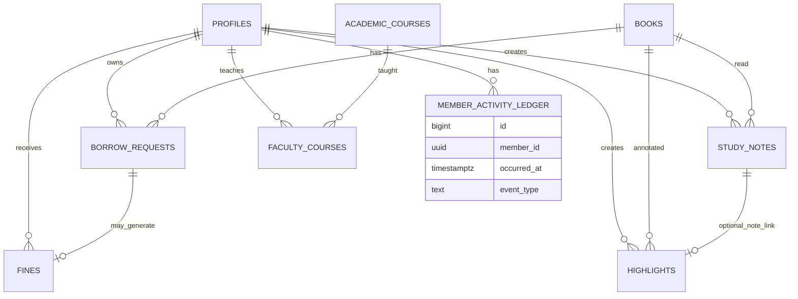

# Smart Lib schema and app model

This document captures the Supabase database schema and app flow actually used by the project.

For a **new, empty Supabase project**, use [`supabase/COMPLETE_SCHEMA.sql`](supabase/COMPLETE_SCHEMA.sql), which includes the `20261109` lesson workflow and the `20261108120000` policy/audit migration alongside the earlier baseline and cleanup migrations. It includes cleanup for retired review, wishlist, and faculty course-assignment tables. It is not a reset script and should not be run against a populated production database. Existing installations should continue with reviewed migrations and a backup; the two `20261028` filenames still need reconciliation against that project's migration history before using the Supabase CLI.

## 1. Core auth and role model

### `public.profiles`
Used for role-aware auth routing and member profile details.

| Field | Type | Notes |
| --- | --- | --- |
| `id` | `uuid` | Supabase auth user id |
| `email` | `text` | Login email |
| `role` | `text` | `admin`, `librarian`, `faculty`, or `student` |
| `full_name` | `text` | Optional display name |
| `school` | `text` | Legacy field; current product has one school |
| `department` | `text` | Backing field for the controlled faculty choice on faculty profiles |
| `course` | `text` | Student course program; faculty profiles use their department |
| `student_year` | `text` | Student year level |
| `institutional_id` | `text` | Optional unique `NNNN-NNNNN` member ID used by the circulation desk. |
| `student_photo_path` | `text` | Path in the private `student-headshots` bucket; staff view it through short-lived signed URLs. |
| `faculty_rank_id` | `bigint` | Legacy compatibility field; not used in the current account flow |
| `created_at` | `timestamptz` | Default timestamp |

Typical app behavior:
- `/dashboard` checks `profiles.role`
- `admin` redirects to `/dashboard/admin`
- `student` and `faculty` redirect to `/dashboard/student`
- Disable public sign-up in the Supabase Auth settings (`enable_signup = false`); keep the server-side Auth Admin invitation route enabled for staff-provisioned accounts. Do not enforce this with an `auth.users` trigger: Supabase uses the same database role for public sign-ups and Auth Admin invitations.
- Administrators may create/delete accounts and assign roles. Librarians may invite students and faculty only after checking a physical school ID in person; the server records the staff attestation in `audit_logs`, retains no ID image, and sends a secure invitation so the member sets their own password. Librarians cannot create staff accounts, delete accounts, or change roles.
- Students choose a course and year level. Faculty accounts use a controlled department choice; the school is fixed and not a member choice.
- Members can update only permitted personal details and cannot self-promote or edit protected academic assignments.
- Counter checkout and return procedures require staff to confirm that the physical institutional ID card was presented. Staff ID checks are written to `audit_logs`; headshots use private storage and staff-only access.

### Legacy rank and current course catalogs

| Table | Purpose |
| --- | --- |
| `public.faculty_ranks` | Legacy schema table; not exposed or used by the current account flow. |
| `public.academic_courses` | Administrator-managed courses. Students select a course from this catalog when an administrator creates or edits an account. |

Authenticated users can read active choices; only administrators can manage catalogs. Faculty course assignments have been removed. Rank data is retained only for legacy profile compatibility.

## 2. Library catalog and lending flow

Physical circulation is handled separately from digital loans. Physical copies, physical requests, fees, and payment records must not change e-book availability or automatic points-based access.

`public.books.catalog_type` distinguishes `digital`, `physical`, and `hybrid` catalog entries. E-books have no stock or copy limit; `total_copies` and `available_copies` are legacy columns and must not control digital access. Physical inventory is managed only through `public.physical_book_copies`. Physical-only titles are excluded from the digital-reader catalog and access RPC.

### Physical collection and circulation

| Table | Purpose |
| --- | --- |
| `public.physical_book_copies` | One row per physical copy, with a unique code and QR token. Copy rows remain restricted to authenticated access; anonymous visitors use narrow read-only catalog and QR lookup RPCs that omit borrower identity and the QR token. |
| `public.physical_loan_options` | Administrator-managed loan duration and PHP fee per title. |
| `public.physical_book_requests` | Private borrower request, cash checkout status, due date, return status, and issued receipt number. Legacy online-payment metadata is retained for audit only. |
| `public.physical_book_renewals` | Per-renewal duration, configured fee paid, updated due date, institutional-ID attestation, and receipt. |
| `public.physical_book_waitlist` | Private student subscriptions for titles with no currently available copy. Waitlisted students are notified when staff records a returned copy. |

Workflow:
- Signed-in students and faculty browse physical titles through the unified `/dashboard/student` catalog or scan a copy sticker QR code. The QR link opens the catalog and the physical-borrow modal after authentication. Member policies expose only the signed-in user’s requests; borrower identities, payment records, and QR tokens are not public.
- Signed-in students and faculty browse the same collection and can request copies or join waitlists. They see their own requests, payments, and receipts only.
- Administrators can create a physical title in `/dashboard/admin/physical`, including title, author, category, ISBN, description, an optional uploaded front-cover image, and initial copies. The catalog record and copy QR entries are created together; more copies can be added later.
- The physical catalog displays each registered title’s cover/details and live available-copy count, so visitors and signed-in members can check availability before visiting the library. A physical title can be reached from the public home/catalog link or the student dashboard’s “Physical books” link.
- Available titles can be requested for a configured loan period. Cash is collected and recorded by the librarian at checkout. Online payments and receipt uploads are not accepted.
- Only the librarian/admin checkout action marks a copy borrowed and marks the payment paid. It issues a receipt number; borrowers can view and print the digital receipt from their account.
- Members can join a FIFO notification queue when no copy is available. A waitlist notification does not reserve a copy. The member must submit a normal borrow request, and a copy is assigned only when library staff confirms checkout. If availability changes before checkout, the request remains pending and staff must retry after checking inventory.
- Pending physical requests have no `copy_id` and do not change copy availability. At checkout, the database selects and locks one available copy transactionally; concurrent checkouts cannot assign the same copy.
- Physical checkout and return RPCs require an explicit staff attestation that the borrower presented their institutional ID. The desk accepts 9-digit IDs and formats them as `NNNN-NNNNN`; `/` and `Ctrl+K` focus the member search. Student photos are stored in the private `student-headshots` bucket and served through short-lived staff-only URLs.
- Physical-loan renewals are performed by library staff at the desk and require the same institutional-ID/photo verification. Staff choose from the title's active loan durations and configured fees; the exact fee is collected for every renewal, there is no renewal-count limit, and the new due date is calculated from the renewal timestamp. Overdue/lost loans, open incidents, and unpaid physical fines above PHP 100 block renewal. Each renewal has a separate receipt and audit record while preserving the original checkout fee and receipt.
- A member may have at most three active physical loans by default. `checked_out` and `return_pending` count until staff completes return inspection. A database trigger serializes member checkout transitions and rejects a fourth active loan; the request control is disabled at the limit. The default cap is pending Head Librarian confirmation.
- Overdue and lost items prevent new physical requests until resolved. This is a library-only hold and does not affect enrollment, grades, or transcripts.
- Historical online-payment request records and their references are retained for audit only. They cannot be checked out or edited as payments; staff should reject an old pending request and ask the member to submit a new cash request.
- The current `vercel.json` schedule calls `/api/cron/physical-reminders` daily at 16:00 UTC (midnight Asia/Manila) to create due-soon/overdue in-app notifications. Use an external scheduler if the library requires more frequent updates. Configure `CRON_SECRET` and `SUPABASE_SERVICE_ROLE_KEY` only in the server environment. Actual email sending requires a separate worker/provider; the endpoint does not claim an email has been sent.

### Automatic e-book access and AI review

| Table / feature | Purpose |
| --- | --- |
| `public.borrow_requests` | Free or points-based e-book access. `request_digital_loan()` deducts any required points and creates an approved loan in one database transaction. |
| `public.book_access_grants` | Other explicit, administrator-issued access grants; not required for ordinary free/points e-book unlocks. |
| Legacy `public.ebook_purchase_requests` | Retained for historical online purchase records; new submissions are disabled. |
| Contribution AI screening | Gemini scores and summarizes a contributed PDF as an advisory; every result requires a human administrator decision. |
| Library chat assistant | Gemini answers using matching catalog records and, for a signed-in user's own loan questions, limited loan status details. |

Free and points-based e-books unlock immediately after the database confirms the request; eligible point costs are deducted atomically. E-books do not consume physical stock and do not wait for librarian approval. The current project has no online payment gateway account or verified payment webhook. New online payment submissions are disabled; new premium e-book listings are blocked. Existing premium entries are shown as unavailable until an administrator configures them for free/points access.

Physical book payments are cash-only and are collected by library staff at checkout. No online payment provider or receipt-upload flow is part of the current system.

`GEMINI_API_KEY` is server-only; `GEMINI_MODEL` is optional and defaults to `gemini-3.8-flash`. If a configured model returns Google's explicit retirement notice with its recommended replacement model, the server retries once using that replacement. Transient HTTP 503 responses are retried twice with backoff, honoring a bounded `Retry-After` delay when provided. The library chat sends the user's message, up to eight recent conversation messages, matching catalog details, and (for loan questions) up to 20 of that signed-in user's loan status/title/due-date records to Google Gemini. Contribution screening sends extracted PDF text (up to 40 pages / 60,000 characters) to Google Gemini. Online payments are not supported. Contribution review remains advisory and the administrator makes the final decision. Without a Gemini key, the regular manual contribution-review workflow remains available.

The reading-session cover blurs the reader when the browser tab is hidden or the window loses focus. It is a privacy deterrent, not reliable screenshot prevention; screenshots may still be captured while the page is active.

### `public.books`
Main catalog table.

| Field | Type | Notes |
| --- | --- | --- |
| `id` | `bigint` | Primary key |
| `title` | `text` | Book title |
| `author` | `text` | Author name |
| `category` | `text` | Legacy display field kept for compatibility; new forms mirror discipline or genre here. |
| `discipline` | `text` | Academic discipline, separate from course codes, genres, and acquisition source. |
| `genre` | `text` | Optional genre or material classification. |
| `course_code` | `text` | Optional course code such as `BIO101`. |
| `source_type` | `text` | `catalog`, `staff_added`, or `community_contribution`. |
| `isbn` | `text` | Optional |
| `description` | `text` | Summary |
| `total_copies` | `int` | Legacy field; digital e-books have no stock limit. Physical copies are stored in `physical_book_copies`. |
| `available_copies` | `int` | Legacy field; must not restrict e-book access. |
| `pdf_url` | `text` | PDF file URL for e-reader |
| `cover_image_url` | `text` | Optional public cover image URL, used in the physical catalog |
| `catalog_type` | `text` | `digital`, `physical`, or `hybrid`; physical-only records are not digitally lendable |
| `created_at` | `timestamptz` | Insertion time |
| `search_vector` | `tsvector` | Full-text index used by `search_books()` |

Notes:
- Admins create books from the admin dashboard.
- Course-code-shaped legacy categories are moved to `course_code`; community-contribution labels are represented by `source_type`; legacy discipline and genre values are backfilled to their respective fields.
- The admin category chart reports disciplines only and does not combine genre, course-code, or source-type values.
- The student dashboard queries book metadata. Physical availability and locations come from the public physical-catalog projection, not the legacy `books.available_copies` field.
- `pdf_url` is used by `/reader/[bookId]`.
- `search_vector` is used for the recommendation / full-text search flow.

### `public.borrow_requests`
Represents a member's digital access request.

| Field | Type | Notes |
| --- | --- | --- |
| `id` | `bigint` | Primary key |
| `student_id` | `uuid` | References `profiles.id` |
| `book_id` | `bigint` | References `books.id` |
| `status` | `text` | `approved` immediately for eligible free/points access; `pending` is retained for legacy records and is not a routine approval workflow |
| `request_date` | `timestamptz` | Created when student requests |
| `due_date` | `timestamptz` | Set when digital access is unlocked; reader access expires automatically at this time |
| `returned_date` | `timestamptz` | Historical closure field; members do not manually return digital loans |
| `notes` | `text` | Optional admin or student notes |

Behavior:
- `request_digital_loan()` checks access eligibility, prevents duplicate active loans, and verifies the member's balance atomically. It accepts the dashboard periods of 1, 3, 7, 14, and 30 days.
- Eligible free and points-based requests are immediately approved and unlocked when submitted; no librarian approval is required. For point-priced materials, `access_points` is the 7-day rate and the selected period costs `ceil(access_points * duration_days / 7)` points, rounded up to a whole point. Free materials cost zero.
- An approved digital loan is active only while its `due_date` is in the future. The reader API denies file access after expiration, the member dashboard removes it from active access and lists it as expired, and members can renew only before expiration. Authenticated members cannot execute the legacy `return_digital_loan()` RPC.
- Restricted materials remain administrator-only.
- The selected lending duration sets the due date; a confirmation appears in the member notification list.

### `public.digital_book_loan_history`
One synchronized history row per digital borrowing request. A trigger copies request, due-date, return, renewal, points, and status fields from `borrow_requests`; it is a mutable per-loan projection, not an append-only event log.

Unlike the active-access view, this row is retained after access expires or a loan is returned. `borrow_requests` remains the source of truth for current access state.

### `public.physical_book_loan_history`
One synchronized history row per completed physical checkout. A trigger copies checkout and return state from `physical_book_requests`; the request/copy transaction remains authoritative for current circulation state.

### `public.member_activity_ledger`

Append-only chronological history for consequential account actions. Database triggers record physical requests, checkout/return/lost decisions, fines and their payment/waiver, print and digital purchase receipts, digital access, points, contributions, availability alerts, controlled profile changes, account creation/deletion, and book catalog changes. Events carry a member UUID, timestamp, actor role, narrative, source entity/request identifiers, receipt number when available, and limited non-secret details. Existing trustworthy timestamps are backfilled; earlier decision times that were never stored are not fabricated. Members can read their own records, administrators can review all histories, and librarians can read circulation/financial event types. Loan and financial source tables remain authoritative, and clients cannot insert or edit ledger records.

### Points wallet and faculty lessons

- Students may receive points only from a librarian/admin-recorded cash top-up. The fixed bundles are 200 points for PHP 10, 500 for PHP 22, and 1,000 for PHP 40; a top-up is limited to one bundle (at most 1,000 points). The staff RPC verifies the member role and bundle, updates the balance and point ledger atomically, issues a unique receipt, and writes an admin audit event.
- Faculty may buy the same bundles and may earn a configurable reward (25 points by default, 0–100 per approval) for an administrator-approved lesson. Lesson submissions remain in `book_contributions` for compatibility, but are marked `material_type = 'lesson'`; approval publishes them on the member lesson shelf and never inserts a row into `books`.
- Rows marked `material_type = 'legacy_book'` represent resources that were already approved into the book catalog before the lesson-only rule. Only administrators can add books to the catalog.
- Librarians and administrators record cash top-ups only after receiving cash. The system stores bundle, PHP amount, staff actor, timestamp, and receipt number; it does not store ID images or handle member passwords.

### `public.library_policy_settings`

The singleton row contains editable physical fine grace days, daily fine, per-item fine cap, days until lost classification, the default faculty lesson reward, and the student-facing policy notice. Administrators change it through `admin_update_library_policy`; members may read the public settings, and direct client writes are revoked. Fixed point top-up bundles remain 200/PHP 10, 500/PHP 22, and 1,000/PHP 40.

Each new `physical_book_requests` row snapshots `policy_grace_days`, `policy_daily_fine`, `policy_fine_cap`, and `policy_lost_days`. Fine calculation and lost classification use those saved values, so later policy edits do not rewrite terms for existing loans. Existing rows retain the historic defaults when these columns are first introduced.

## 3. Student features

## 4. Fines and notifications

### `public.fines`
Tracks overdue fees.

The existing daily accrual policy remains ₱5 per chargeable day, with a 2-day grace period, Sundays and library holidays excluded, a ₱500 per-item cap, and automatic lost classification after 30 overdue days. A shared borrowing hold applies when unpaid physical fines exceed ₱100. Fine waivers require a structured Medical Excuse or Administrative Exemption category plus justification and are recorded in `audit_logs`.

| Field | Type | Notes |
| --- | --- | --- |
| `id` | `bigint` | Primary key |
| `borrow_request_id` | `bigint` | Borrow record |
| `student_id` | `uuid` | Student charged |
| `amount` | `numeric(10,2)` | Fine total |
| `status` | `text` | `unpaid` or `paid` |
| `created_at` | `timestamptz` | Record created |
| `paid_at` | `timestamptz` | Optional payment timestamp |

The Vercel Cron schedule calls `/api/cron/physical-reminders` at 16:00 UTC (midnight Asia/Manila) to run fine accrual and library maintenance. The endpoint requires `CRON_SECRET` and Supabase service-role configuration.

### `public.email_queue`
Background async notifications queue.

| Field | Type | Notes |
| --- | --- | --- |
| `id` | `bigint` | Primary key |
| `event_type` | `text` | e.g. `borrow_request_status` |
| `payload` | `jsonb` | Event data |
| `processed` | `bool` | Queue state |
| `created_at` | `timestamptz` | Insert time |
| `processed_at` | `timestamptz` | Completion time |

This is meant to be consumed by a worker or Edge Function.

## 5. E-Study Room / PDF reader

The reader overlays the signed-in member's name/email as a visible watermark, disables the context menu, and hides the reader when printing. These are deterrents only: a browser cannot reliably prevent operating-system screenshots or photography.

### `public.study_notes`
Student-created study notes attached to a book + page.

| Field | Type | Notes |
| --- | --- | --- |
| `id` | `bigint` | Primary key |
| `user_id` | `uuid` | Auth user |
| `book_id` | `bigint` | Book being studied |
| `page` | `int` | PDF page number |
| `text` | `text` | Main note content |
| `selection_text` | `text` | Captured text selection |
| `meta` | `jsonb` | Extra detail (future use) |
| `created_at` | `timestamptz` | Insert time |
| `updated_at` | `timestamptz` | Last update |

### `public.highlights`
Page highlight regions for reader overlays.

| Field | Type | Notes |
| --- | --- | --- |
| `id` | `bigint` | Primary key |
| `user_id` | `uuid` | Auth user |
| `book_id` | `bigint` | Book |
| `page` | `int` | PDF page |
| `rects` | `jsonb` | Highlight coordinates |
| `color` | `text` | Highlight color |
| `note_id` | `bigint` | Optional note link |
| `meta` | `jsonb` | Extra metadata |
| `created_at` | `timestamptz` | Insert time |

## 6. Search model

### `public.search_books(p_query, p_limit)`
This SQL function uses `tsvector` and full-text search for ranked results.

Behavior:
- Builds `search_vector` from title + description + category
- Uses `plainto_tsquery('english', ...)`
- Orders by `ts_rank()`
- Returns ranked book results to the app recommendation API

## 7. Relationship map

## 8. Operational decisions and release checks

- The three-active-physical-loan default is implemented but remains pending the Head Librarian's final policy confirmation.
- Apply the latest numbered migrations in order and verify Supabase Realtime publication membership and ledger row-level security in the deployed project.
- The physical maintenance endpoint requires a configured external scheduler and `CRON_SECRET`; verify its schedule and job health in the deployment environment.
- Continue to treat the activity ledger as a chronological index; source loan, fine, payment, and points tables remain authoritative.

## 9. Working app-level flow

1. User signs in via Supabase auth.
2. `/dashboard` resolves role from `profiles`.
3. Student sees catalog, requests, borrowed books, notes, and recommendations.
4. Admin sees metrics, add-book form, requests, and approval actions.
5. Book PDF is displayed in the E-Study Room.
6. Highlighted quotes and notes are saved to `study_notes` / `highlights`.
7. Borrow event triggers notification queue and later fines processing.

## 10. Initialization

For a **new, empty Supabase project**, run [`supabase/COMPLETE_SCHEMA.sql`](supabase/COMPLETE_SCHEMA.sql) once. It already consolidates the lesson workflow and policy/audit changes; applying migrations represented in the consolidated schema afterward is redundant and can fail when a migration attempts to create a function already present. Existing installations must not run the complete schema: review their actual migration history and apply only pending migrations against a backup or staging copy first.

**Do not run it against an existing database with data.** Existing installations need applicable migrations reviewed against their actual schema state and tested against a backup in staging before production. The migration files under `supabase/migrations/` are retained for incremental updates; they are not a complete database migration history and should not be applied blindly.

The behavioral pgTAP suite is `supabase/tests/database/workflows.pgtap.sql`. It remains separate from the setup script and from `npm test`; run it against a disposable local Supabase database after applying the complete schema.

Set `GEMINI_API_KEY` in the server environment to enable contribution screening; set `GEMINI_MODEL` only when selecting a different supported model. No scheduler is required for digital access expiration because the reader and storage policies check `due_date` at access time. The optional maintenance endpoint can be called manually with `CRON_SECRET` if physical reminders, waitlist cleanup, or fine recalculation are later needed. Do not expose these values with `NEXT_PUBLIC_` variables. Free/points digital access is automatic; physical borrowing and contribution acceptance remain librarian/admin-controlled. Paid e-book checkout must remain disabled until a provider webhook can verify payment automatically.

## 11. Application backups

The administrator can manually create a backup from **Admin → Backups**. Scheduled Vercel backups are disabled; `vercel.json` schedules only the physical-reminders endpoint. Manual requests require an authenticated administrator. The backup endpoint uses the Supabase service-role key only on the server.

Backups are compressed JSON Lines archives in a dedicated Google Drive folder configured by `GOOGLE_DRIVE_BACKUP_FOLDER_ID`. Configure that folder with appropriately restricted access; the project does not automatically delete older snapshots. Archives include application table rows, Supabase Auth account metadata (excluding passwords and sessions), Supabase Storage object contents, and Smart Lib-managed Drive PDFs referenced by books and contributions. They do not copy unrelated files from Drive. A missing optional database table is disclosed in the archive summary; other read failures abort the backup.

This application-level export is not a transactionally consistent database dump and cannot restore passwords or active sessions. Use Supabase-native backups/PITR as an additional recovery layer, and validate logical restoration in an isolated Supabase project before applying anything to production.
